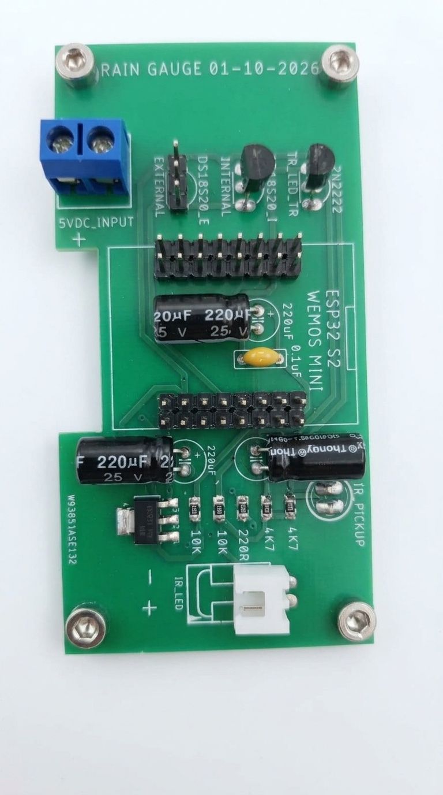
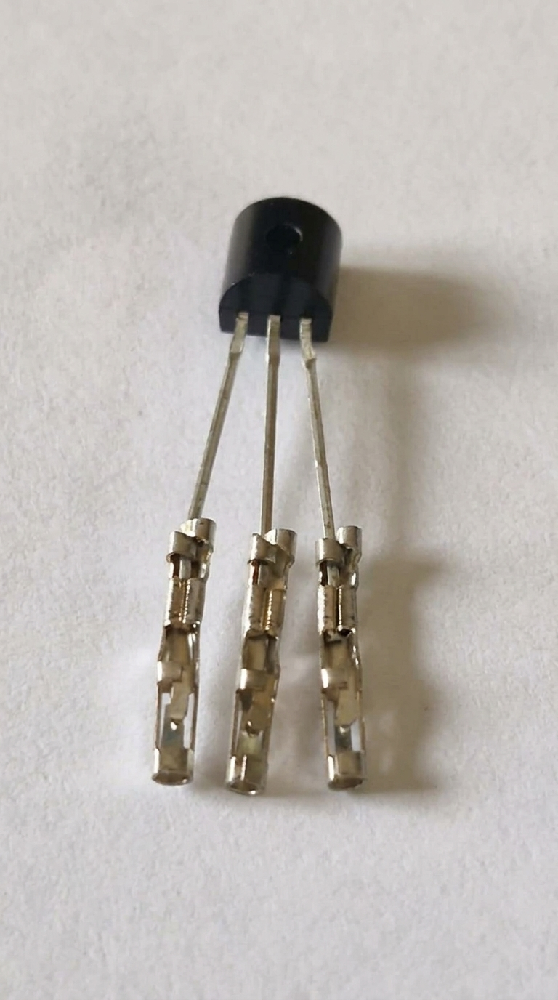
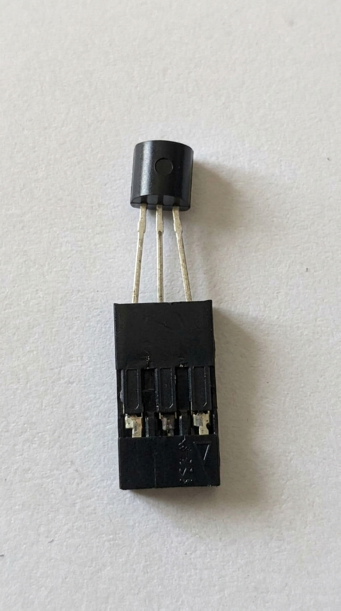
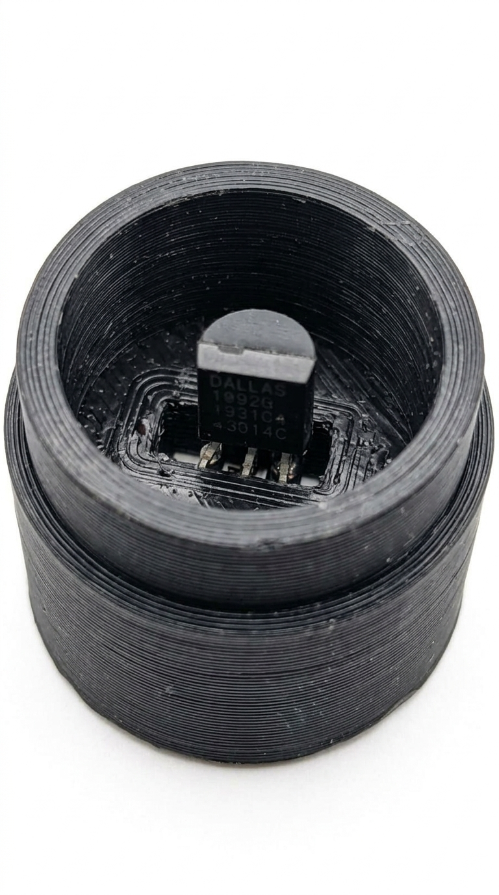
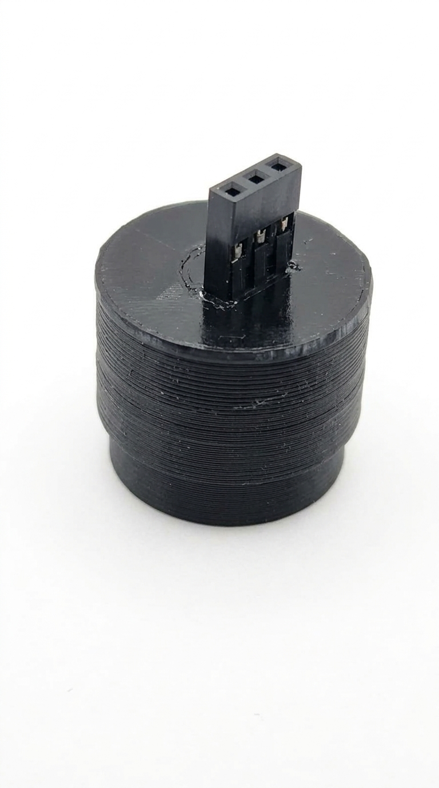

# Rain Gauge — Printing and Assembly

> This guide grows while the next gauge is built. Steps marked **(to be
> completed)** get more detail and photos then.

## 1. Printing the parts

All parts were printed in **ABS** on an FDM 3D printer.

**Print them exactly as they are in the STL files — do not rotate them.**
Every part is already saved in its print position: when you load an STL into a
slicer such as **Cura**, it lies on the build plate the right way up, with its
flat side down. Just place it on the plate and slice.

| File | Part | Size (X × Y × height) |
|---|---|---|
| `RM_Top.stl` | Top with the funnel — 146 mm across (= *Funnel Diameter* on the SETTINGS page) | 146 × 146 × 88.6 mm |
| `RM_Mid.stl` | Middle section | 146 × 146 × 74.5 mm |
| `RM_Base.stl` | Base | 139 × 115 × 65 mm |
| `RainMeterTipper.stl` | Tipping bucket | 98 × 23 × 28 mm |
| `PCBLift.stl` | PCB lift / spacer | 44 × 24 × 3 mm |
| `TempSupportPlug.stl` | Holder for the outside temperature sensor | 21 × 21 × 17.5 mm |

Notes:

- The top and middle need a build plate of at least **150 × 150 mm**.
- ABS warps and cracks when it cools unevenly: an enclosed printer (or a
  draught-free room) and a heated bed help.
- `RainMeterTipper.stl` touches the plate with only a small area — a **brim**
  helps it stay down.
- The tipping bucket must swing freely and the same way to both sides: clean
  any strings or blobs from the pivot after printing.
- If you change the funnel size, set the new inside diameter on the SETTINGS
  page (*Funnel Diameter*) — the rain in mm is worked out from it.

## 2. What else you need

- **PCB RAINMETER_V1** — gerbers in [`../PCB`](../PCB) (order from any PCB maker)
  and the parts below
- **WEMOS LOLIN S2 Mini** (ESP32-S2)
- **IR LED** and **IR pickup** (the beam the tipping bucket breaks)
- **DS18S20** temperature sensor for outside (a second one on the PCB is optional)
- **Brass heat-set inserts** and matching screws — the parts are screwed together
  into inserts melted into the ABS with a soldering iron
- 3-pin **Dupont** female crimp terminals + housing for the temperature sensor
- A **5 V DC** power supply

## 3. The PCB

Solder the parts as printed on the board:

| On the board | Part |
|---|---|
| `5VDC_INPUT` | 2-pin screw terminal — 5 V supply in (**+** marked) |
| `ESP32 S2 WEMOS MINI` | pin headers for the S2 Mini |
| `2N2222` / `TR_LED_TR` | 2N2222 transistor that switches the IR LED |
| `IR_LED` | 2-pin connector to the IR LED |
| `IR PICKUP` | the IR pickup |
| `EXTERNAL DS18S20_E` | 3-pin header for the outside temperature sensor |
| `INTERNAL DS18S20_I` | optional DS18S20 on the board (inside temperature) |
| `10K`, `10K`, `220R`, `4K7`, `4K7` | resistors (SMD) |
| `220µF` × 3, `0.1µF` | capacitors |

The full schematic is in [`../PCB/RAINMETER_V1.sch`](../PCB) (Eagle).
Back of the board: [`PCB_BACK.jpg`](../docs/pictures/PCB_BACK.jpg).

## 4. The outside temperature sensor

| | |
|---|---|
|  | **a.** Crimp (or solder) a Dupont female terminal on each leg of the DS18S20. |
|  | **b.** Push the three terminals into a 3-pin housing — keep the leg order. |
|  | **c.** Fit it into `TempSupportPlug`: the sensor sits in the cup... |
|  | **d.** ...and the connector comes out at the bottom. |

It connects to the **EXTERNAL DS18S20_E** header on the PCB. **(to be completed:
where the holder fits on the gauge)**

## 5. Assembling the gauge (to be completed)

1. Melt the **brass inserts** into the screw holes of the printed parts with a
   soldering iron (let them cool before screwing into them).
2. Mount the PCB on the **PCBLift** in the **base** and screw it down.
3. Fit the **IR LED** and the **IR pickup** into their holes: the holes in the
   printed parts line them up with the **tipping bucket**, so the beam is broken
   by one side of the bucket and open with the other.
4. Put the **tipping bucket** on its pivot — it must tip freely both ways.
5. Fit the **middle section** and the **top with the funnel**, and screw them
   together.
6. Connect the IR LED to the `IR_LED` connector, the outside sensor to
   `EXTERNAL DS18S20_E`, and 5 V to `5VDC_INPUT`.

## 6. After assembly

1. Install the firmware and set up WiFi — see the
   [install page](https://777bdvgp.github.io/RainGauge/).
2. Tip the bucket by hand and watch **Bucket Position** on the HOME page:
   it must change between **OPEN** (green) and **BROKEN** (red) on every tip.
3. **NTFY page → TEST IR SENSOR NOW** (with the beam OPEN) must report *OK*.
4. Stand the gauge level and **calibrate** it (SETTINGS → CALIBRATION).
5. **SETTINGS → START FRESH** to clear the test tips.
