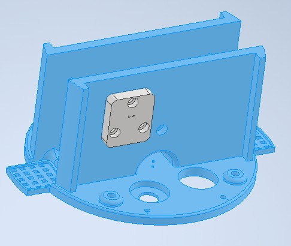
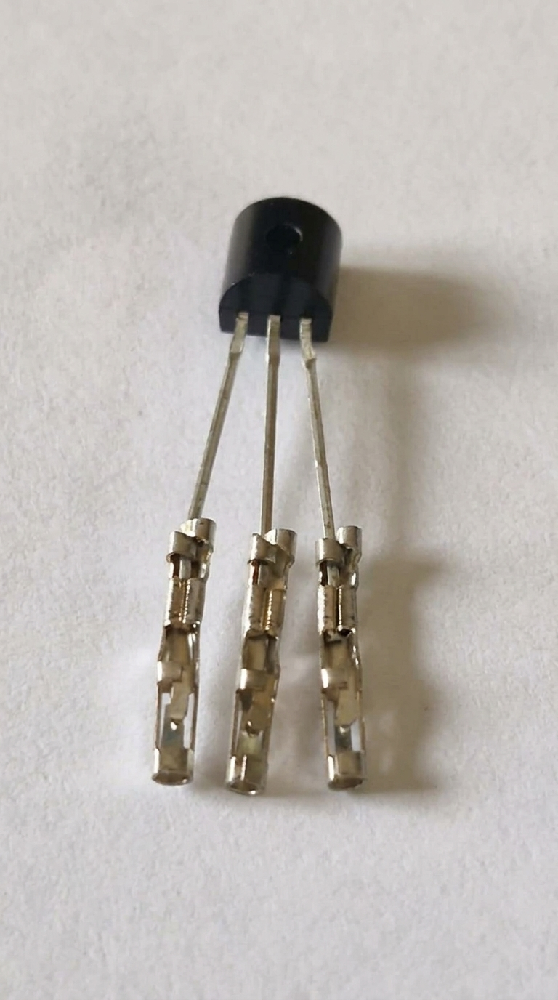
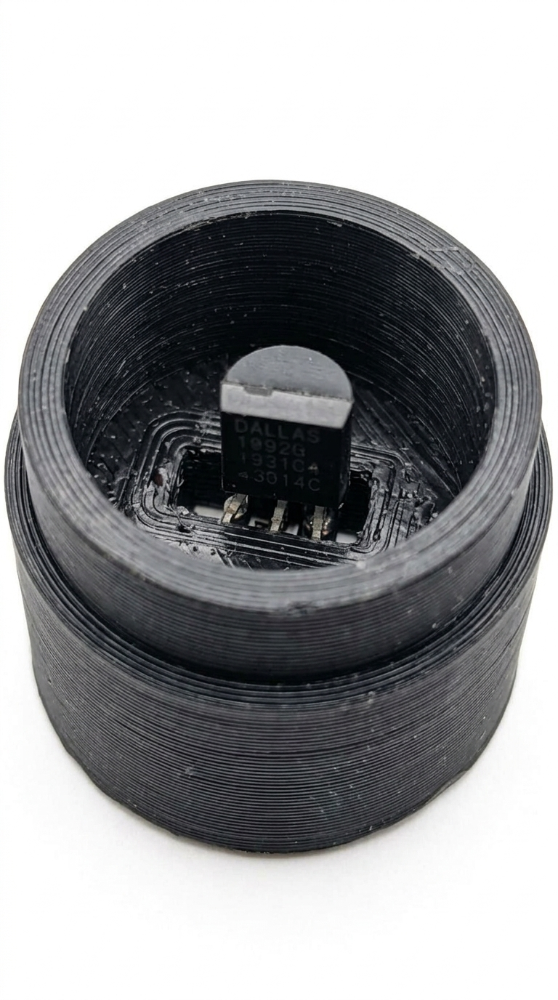
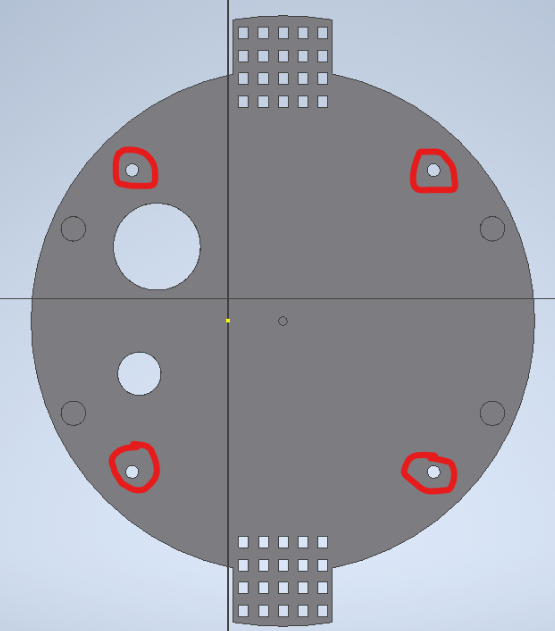

# Rain Gauge

Tipping-bucket rain gauge with an IR beam pickup, outside temperature, rainfall
reports, a daily soil water balance (FAO-56) and an **"irrigate today?"** answer
for an irrigation controller — on a **WEMOS LOLIN S2 Mini** (ESP32-S2). Everything
is a web page on your own WiFi; no cloud, no app needed.

**Install / update page:** https://777bdvgp.github.io/RainGauge/

**Contents:** [Features](#features) · [1. Printing the parts](#1-printing-the-parts) ·
[2. Bill of materials](#2-bill-of-materials-bom) · [3. The PCB](#3-the-pcb) ·
[4. The outside temperature sensor](#4-the-outside-temperature-sensor) ·
[5. Assembling the gauge](#5-assembling-the-gauge) ·
[6. Mounting outside](#6-mounting-outside) ·
[7. Installing the firmware](#7-installing-the-firmware) ·
[8. Testing and calibrating](#8-testing-and-calibrating) · [Updating](#updating) ·
[Pin map](#pin-map) · [Building the firmware yourself](#building-the-firmware-yourself) ·
[Licence](#licence)

> **Who this build guide is for:** someone with some hands-on experience — you can
> solder (including a few small SMD parts), use a 3D printer and slicer, and work
> out small details yourself from the photos and STL files. It is not a
> step-by-step kit manual for a complete beginner.
>
> The guide grows while the next gauge is built. Steps marked
> **(to be completed)** get more detail and photos then.

## Features

- **HOME** — live bucket position (IR beam OPEN / BROKEN), rain today / this month,
  last tip, outside temperature, irrigation answer.
- **REPORTS** — rainfall per month / day / hour, temperature records and daily
  min / max, water balance history.
- **SETTINGS** — WiFi networks (list, add, delete), funnel size, calibration, tip debounce, IR self-test interval,
  irrigation method (*Water Balance*, *Simple Rule* or *No Irrigation*), controller
  name, START FRESH (clear data, keep settings), SIMULATION.
- **NTFY** — free push alerts on your phone (ntfy.sh): IR sensor fault, high / low
  outside temperature; IR sensor test with live beam status.
- **ABOUT** — network, firmware **update from GitHub** (CHECK / INSTALL) or from an
  uploaded `.bin`.
- **`/api/irrigate`** — JSON answer any irrigation controller can poll.

## 1. Printing the parts

All parts were printed in **ABS** on an FDM 3D printer.

**Print them exactly as they are in the STL files — do not rotate them.**
Every part is already saved in its print position: when you load an STL into a
slicer such as **Cura**, it lies on the build plate the right way up, with its
flat side down. Just place it on the plate and slice.

The STL files are in the [`Enclosure/`](Enclosure) folder — click a name below to
see the part in 3D on GitHub, then **Download raw file** (the download icon at the
top right).

| File | Part | Size (X × Y × height) | ABS approx. |
|---|---|---|---|
| [`RM_Top.stl`](Enclosure/RM_Top.stl) | Top with the funnel — 146 mm across (= *Funnel Diameter* on the SETTINGS page) | 146 × 146 × 88.6 mm | 144 g |
| [`RM_Mid.stl`](Enclosure/RM_Mid.stl) | Middle section | 146 × 146 × 74.5 mm | 135 g |
| [`RM_Base.stl`](Enclosure/RM_Base.stl) | Base | 139 × 115 × 65 mm | 80 g |
| [`RainMeterTipper.stl`](Enclosure/RainMeterTipper.stl) | Tipping bucket | 98 × 23 × 28 mm | 9 g |
| [`PCBLift.stl`](Enclosure/PCBLift.stl) | PCB lift / spacer | 44 × 24 × 3 mm | 2 g |
| [`TempSupportPlug.stl`](Enclosure/TempSupportPlug.stl) | Holder for the outside temperature sensor | 21 × 21 × 17.5 mm | 3 g |
| [`IR_LED_Support.stl`](Enclosure/IR_LED_Support.stl) | Holder for the IR LED (instead of the IR holder PCB) | 24 × 27.6 × 6 mm | 3 g |
| [`Mount_Template.stl`](Enclosure/Mount_Template.stl) | Drilling template for the mounting frame (section 6) | 78.7 × 78.7 × 6 mm | 7 g |

Notes:

- The top and middle need a build plate of at least **150 × 150 mm**.
- Weights are estimates for 3 walls + 20 % infill; all parts together ≈ **390 g** of ABS (with the drilling template).
- ABS warps and cracks when it cools unevenly: an enclosed printer (or a
  draught-free room) and a heated bed help.
- `RainMeterTipper.stl` touches the plate with only a small area — a **brim**
  helps it stay down.
- The tipping bucket must swing freely and the same way to both sides: clean
  any strings or blobs from the pivot after printing.
- After printing, the top and middle are glued, sanded and painted — see
  [section 5](#5-assembling-the-gauge).
- If you change the funnel size, set the new inside diameter on the SETTINGS
  page (*Funnel Diameter*) — the rain in mm is worked out from it.

## 2. Bill of materials (BOM)

Quantities for **one** gauge. Part names in `code` are the names printed on the PCB.

### Main PCB — RAINMETER_V1 (values from [`PCB/RAINMETER_V1.sch`](PCB))

| Qty | Part | On the board | Notes |
|---|---|---|---|
| 1 | PCB RAINMETER_V1 | — | gerbers: [`PCB/RAINMETER_V1_2026-10-04.zip`](PCB) — upload to [PCBWay](https://www.pcbway.com/) (the maker I use and recommend) or any other PCB maker; 2 layers, 1.6 mm, default settings |
| 1 | WEMOS LOLIN S2 Mini (ESP32-S2, 4 MB flash, 2 MB PSRAM) | `ESP32 S2 WEMOS MINI` | |
| 2 + 2 | Pin headers 2 × 8, 2.54 mm | `ESP32 S2 WEMOS MINI` | they come with the S2 Mini when you order it: **male on the PCB**, **female on the S2 Mini** |
| 1 | AMS1117 voltage regulator, SOT-223 | `AMS1` | |
| 1 | 2N2222 transistor, TO-92 | `IR_LED_TR` | switches the IR LED |
| 2 | Resistor 10K, SMD 0805 | `R2`, `R8` | |
| 1 | Resistor 220R, SMD 0805 | `R7` | IR LED current (~16 mA) |
| 2 | Resistor 4K7, SMD 0805 | `R1`, `R3` | DS18S20 pull-ups |
| 3 | Capacitor 220 µF, 25 V electrolytic, 2.5 mm pitch, 5 mm diameter | `C1`, `C2`, `C7` | |
| 1 | Capacitor 0.1 µF ceramic | `C5` | |
| 1 | Screw terminal 2-pin, 5.08 mm pitch | `5VDC_INPUT` | |
| 1 | Molex C-Grid connector 2-pin (70553-02) + mating 2-pin housing and crimps | `IR_LED` | cable to the IR LED |
| 1 | 3-pin header, 2.54 mm | `DS18S20_E` | outside temperature sensor plugs in here |
| 1 | IR pickup: Vishay **BPV11F** — 5 mm NPN phototransistor with daylight filter, for 900–950 nm | `IR PICKUP` | has a **base leg**: not used — only collector and emitter go into the 2 holes (see the note under the BOM) |
| 0–1 | DS18S20, TO-92 | `DS18S20_I` | **optional**, inside temperature (technical use only) |
| 4 | Screws **M3 × 10 mm** for the PCB corners | — | into the brass inserts in the base |

### IR LED — choose one way

| Qty | Part | Notes |
|---|---|---|
| 1 | IR LED: Vishay **TSAL6200** — 5 mm, 940 nm (alternative if out of stock: Everlight IR333-A, also 940 nm) | driven at ~16 mA |
| **either** | | |
| 1 | IR holder PCB RAINMETER_IR_HOLDER + Molex C-Grid 70553-02 connector | gerbers: [`PCB/RAINMETER_IR_HOLDER_2026-11-21.zip`](PCB) |
| **or** | | |
| 1 | Printed holder `IR_LED_Support.stl` | no extra PCB; wires soldered directly onto the LED legs |
| 2 | Wires, 200 mm, different colours | from the IR LED to the `IR_LED` connector |

### Outside temperature sensor

| Qty | Part | Notes |
|---|---|---|
| 1 | DS18S20, TO-92 | |
| 3 | Dupont female crimp terminals | one per leg |
| 1 | Dupont 3-pin housing, 2.54 mm | |
| 1 | Printed holder `TempSupportPlug.stl` | |
| 3 | Wires, 200 mm, different colours | from the sensor to `DS18S20_E` |

### Printed parts and finishing

| Qty | Part | Notes |
|---|---|---|
| 1 each | `RM_Top`, `RM_Mid`, `RM_Base`, `RainMeterTipper`, `PCBLift`, `TempSupportPlug`, `Mount_Template` (+ `IR_LED_Support` if used) | see section 1 |
| ~390 g | ABS filament, 1.75 mm (≈ 155 m) | estimated from the STL files with 3 walls + 20 % infill, without supports; solid (100 % infill) would be ~520 g. One 1 kg spool is plenty |
| — | ABS glue (ABS cement / solvent glue) | top + middle section |
| — | Sandpaper | funnel inside and outside |
| — | White paint (outdoor) | reflects the sun |

### Mechanical

| Qty | Part | Notes |
|---|---|---|
| 20 | Brass heat-set inserts **M3**, **4 mm long** | melted into the base — 16 for the top, 4 for the PCB |
| 16 | Screws **M3 × 25 mm** | top → base, into the brass inserts |
| 1 | Pivot / axle for the tipping bucket, **40 mm** | use a long screw and **cut off the thread at the end**, so the part of the shaft the tipper swings on is **smooth** |
| 1 | Cable gland / grommet for a **10 mm hole** | power and sensor cables in, watertight |
| 1 | **3D printer bed-levelling kit** (M3 bolts, springs and knurled nuts) | for the 4 Ø 3.0 mm mounting holes — the springs let you level the gauge (section 6) |
| — | Mounting hardware (pole, wall bracket, angle iron frame, frame) | **for the builder to improvise** — see section 6; the 4 mounting holes are Ø 3.0 mm on a 68.7 mm square, `Mount_Template.stl` helps to drill the frame |

### Power

| Qty | Part | Notes |
|---|---|---|
| 1 | 5 V DC power supply, at least 1 A — **an old cellphone charger works well** | **check that it gives 5 V DC** (not 9 / 12 V fast-charge, not AC) — measure it before connecting; into `5VDC_INPUT` (**+** marked) |
| 1 | 2-wire power cable, outdoor rated | length to suit where the gauge stands; in through the cable gland |

**About the IR LED and pickup:** the pickup is read with a 10K pull-up — the
input is LOW when it receives light — so it must be an **NPN phototransistor**,
and the LED and pickup must work at the **same wavelength (940 nm)**. A pickup
with a **daylight filter** (black body) is much less disturbed by sunlight. The
recommended pair is the Vishay **TSAL6200** (LED) + **BPV11F** (pickup); any 5 mm
940 nm IR LED + 940 nm NPN phototransistor pair works too.

The BPV11F has a third leg, the **base** — it is not used: look up in its datasheet
which leg is the base, cut it off, and solder **collector and emitter** into the two
`IR PICKUP` holes. If **Bucket Position** on the HOME page never changes when you
tip the bucket, the pickup is the wrong way round — turn it around.

## 3. The PCB

**Ordering the boards:** upload the Gerber ZIP from [`PCB/`](PCB) to [PCBWay](https://www.pcbway.com/) —
I have my own boards made there and can recommend them: easy to order, good quality and quick
delivery. Default settings (2 layers, 1.6 mm) are fine. Any other PCB maker works too.


Solder the parts as printed on the board:

| On the board | Part (from the schematic) |
|---|---|
| `5VDC_INPUT` | 2-pin screw terminal, 5.08 mm pitch — 5 V supply in (**+** marked) |
| `AMS1` | AMS1117 voltage regulator (SOT-223) |
| `ESP32 S2 WEMOS MINI` | pin headers / sockets for the WEMOS LOLIN S2 Mini |
| `IR_LED_TR` | 2N2222 transistor (TO-92) that switches the IR LED |
| `IR_LED` | 2-pin Molex C-Grid connector (70553-02) to the IR LED |
| `IR PICKUP` | 5 mm IR pickup |
| `DS18S20_E` (EXTERNAL) | 3-pin header for the outside DS18S20 |
| `DS18S20_I` (INTERNAL) | optional DS18S20 soldered on the board (inside temperature) |
| `R2`, `R8` | 10K resistors, SMD **0805** |
| `R7` | 220R resistor, SMD 0805 (IR LED current) |
| `R1`, `R3` | 4K7 resistors, SMD 0805 (DS18S20 pull-ups) |
| `C1`, `C2`, `C7` | 220 µF electrolytic capacitors (25 V) |
| `C5` | 0.1 µF ceramic capacitor |

The full schematic is in [`PCB/RAINMETER_V1.sch`](PCB) (Eagle).
Back of the board: [`PCB_BACK.jpg`](docs/pictures/PCB_BACK.jpg).

### The IR LED: two ways to mount it

The IR LED sits opposite the IR pickup, so the tipping bucket breaks the beam
between them. It connects to the `IR_LED` connector on the main PCB.

- **IR holder PCB** — a small extra board, **36.7 × 22.1 mm**, with only the
  5 mm IR LED and a 2-pin connector (Molex C-Grid 70553-02) for the cable to the
  main PCB. Eagle files and gerbers:
  [`PCB/RAINMETER_IR_HOLDER*`](PCB). Neat, but it is one more PCB to order.
- **Printed holder — cheaper alternative:**
  [`IR_LED_Support.stl`](Enclosure/IR_LED_Support.stl) (24 × 27.6 × 6 mm, printed
  like the other parts). No extra PCB needed:
  1. Push the **legs of the IR LED through the two small holes** in the middle of
     the holder.
  2. **Solder the two wires of a cable directly onto the legs** on the other side
     and plug the cable into the `IR_LED` connector on the main PCB
     — mind the **+** (the long leg of the LED is +).
  3. Mount the holder **as shown in the picture below**: on the wall of the base,
     over the hole the beam shines through.

  

  *The printed holder (grey) on the outside of the wall in the base (blue),
  over the hole the beam shines through.*

## 4. The outside temperature sensor

| | |
|---|---|
|  | **a.** Crimp (or solder) a Dupont female terminal on each leg of the DS18S20. |
|  | **b.** Push the three terminals into a 3-pin housing — keep the leg order. |
|  | **c.** Fit it into `TempSupportPlug`: the sensor sits in the cup... |
|  | **d.** ...and the connector comes out at the bottom. |

It connects to the **EXTERNAL DS18S20_E** header on the PCB. **(to be completed:
where the holder fits on the gauge)**

## 5. Assembling the gauge

**(to be completed)**

**The top and middle section (funnel):**

1. **Glue** the **top** (`RM_Top`) and the **middle section** (`RM_Mid`) together
   with an **ABS glue** (ABS cement / solvent glue for ABS). Let it cure fully.
2. **Sand** the **outside** and the **inside of the funnel** smooth — a smooth funnel
   lets the water run down quickly and leaves no drops behind.
3. **Open the small hole at the bottom of the funnel** properly (drill or file it
   clean): all the water must run through it into the tipping bucket. A half-closed
   hole slows the water down or lets it build up in the funnel.
4. **Paint** it. **White** is best: it reflects the sun, so the gauge (and the
   temperature inside it) heats up as little as possible.

**The base and the electronics:**

5. Melt the 20 **M3 brass inserts** (4 mm long) into the screw holes of the **base**
   (`RM_Base`) with a soldering iron (let them cool before screwing into them).
6. Mount the PCB on the **PCBLift** in the **base** and screw it down with 4 × M3 × 10 mm
   screws into the brass inserts.
7. Fit the **IR LED** (on its holder PCB or in the printed holder) and the
   **IR pickup** into their holes: the holes in the printed parts line them up with
   the **tipping bucket**, so the beam is broken by one side of the bucket and open
   with the other.
8. Put the **tipping bucket** on its pivot (a 40 mm screw with the thread cut off
   where the tipper swings, so the shaft is smooth) — it must tip freely both ways.
9. Connect the IR LED to the `IR_LED` connector, the outside sensor to
   `EXTERNAL DS18S20_E`, and 5 V to `5VDC_INPUT`.

**Putting it together:**

10. Fit the glued **top + middle section** onto the **base** and screw it down with
    16 × M3 × 25 mm screws into the brass inserts.

## 6. Mounting outside



The gauge stands on **4 mounting holes** in the bottom of the base (circled in red):
**Ø 3.0 mm**, on a **68.7 × 68.7 mm square** centred on the gauge (97.2 mm across
the diagonal).

How and where you mount it is up to you — some initiative is needed here. What
works well:

- Make a small frame or plate yourself, e.g. from **angle iron** across a pole,
  a wall bracket or a post, and drill 4 holes in it on the same 68.7 mm square.
- **Drilling template:** print [`Mount_Template.stl`](Enclosure/Mount_Template.stl)
  (a flat plate, 78.7 × 78.7 mm, with the 4 holes in exactly the same places as the
  base). Clamp it on the frame, mark or drill through the holes, and the gauge
  fits.
- Bolt the gauge onto it **with a spring on each bolt** between the base and the
  frame — a **3D printer bed-levelling kit** (M3 bolts, springs, knurled nuts) is
  ideal. With the springs you can **level** the gauge by turning the 4 nuts (like
  the bed of a 3D printer): put a spirit level across the top of the funnel and
  adjust until it is level both ways. A gauge that is not level tips early on one
  side and late on the other, and the readings are wrong.
- Place it in the **open**, away from roofs, walls and trees that shelter it from
  the rain or drip onto it (as a rule of thumb, at least twice the height of the
  obstacle away), with the funnel at a convenient height to clean it.
- Leave room for the power cable and the temperature sensor cable underneath.

## 7. Installing the firmware

No PlatformIO needed:

1. Open the [install page](https://777bdvgp.github.io/RainGauge/) in Chrome or Edge,
   plug the S2 Mini into the PC with a USB **data** cable, press **CONNECT**, choose
   **Erase**, then **Install**. (If no port shows up: hold button **0**, tap **RST**,
   release **0**, try again; tap **RST** once more after the install.)
2. The gauge opens the WiFi hotspot **RainGauge-Setup** (the LED blinks fast).
   Connect a phone to it — the setup page opens by itself (otherwise browse to
   `http://192.168.4.1/`). Pick your network, type the password, choose
   **Automatic (DHCP)** or a **fixed IP**, press **SAVE & RESTART**.
3. Put the phone back on your normal WiFi and open `http://raingauge.local/`
   (or the fixed IP). Use a fixed IP when an irrigation controller must read the gauge.

**More networks:** SETTINGS → **WiFi Networks** lists the saved networks (the
passwords are never shown) with **DELETE**, and **ADD NETWORK** for another one. At
start-up the gauge tries the saved networks in range, strongest first. If none of
them can be reached for about 5 minutes, the **RainGauge-Setup** hotspot opens by
itself for 5 minutes, so you can add a network from a phone (it is added to the
list, not replacing the others).

## 8. Testing and calibrating

1. Tip the bucket by hand and watch **Bucket Position** on the HOME page:
   it must change between **OPEN** (green) and **BROKEN** (red) on every tip.
2. **NTFY page → TEST IR SENSOR NOW** (with the beam OPEN) must report *OK*.
3. Stand the gauge level and **calibrate** it (SETTINGS → CALIBRATION): pour a known
   amount of water (default 500 ml) slowly into the funnel — the gauge learns how
   much water one tip is.
4. **SETTINGS → START FRESH** to clear the test tips (settings and calibration are kept).
5. Set the **Irrigation Answer Method** (or *No Irrigation* for a plain rain meter),
   your **latitude**, soil type, root depth and garden factor on SETTINGS, and
   NTFY alerts if you want them.

## Updating

ABOUT page → **CHECK FOR UPDATE** → **INSTALL FROM GITHUB**. The new firmware goes
into the spare app slot and is only used when it arrived complete and verified
(HTTPS with certificate check); settings, calibration and rain history are kept.
Without internet at the gauge: download `docs/firmware/raingauge.bin` and use
**UPLOAD & INSTALL** on the ABOUT page.

## Pin map

| Part | GPIO | Notes |
|---|---|---|
| IR LED (2N2222) | 2 | HIGH = on; LED from 5 V via 220R (~16 mA) |
| IR pickup | 17 | 10k pull-up; LOW = light received, HIGH = beam broken |
| DS18S20 outside | 6 | 4k7 pull-up |
| DS18S20 inside (optional) | 1 | 4k7 pull-up |
| Heartbeat LED | 15 | fast blink = WiFi setup hotspot |

Every change of the pickup (both bucket sides) is one tip.

## Building the firmware yourself

```
cd RainGauge
pio run -e usb -t upload                                  # first time, USB
pio run -e ota -t upload --upload-port <gauge ip>         # later, over WiFi
```

Each build writes `firmware_out/RainGauge_v<ver>.bin` (update) and
`RainGauge_v<ver>_full.bin` (new board). Optional built-in WiFi networks:
`src/wifi_secrets.example.h` (your copy `wifi_secrets.h` is never committed).

Publishing a new version (maintainer): `python sync_from_private.py`, build,
`python update_firmware.py "note"`, commit, push.

## Licence

CC BY-NC 4.0 — see [LICENSE](LICENSE). No warranty: check the irrigation answer
against your own garden before relying on it.
