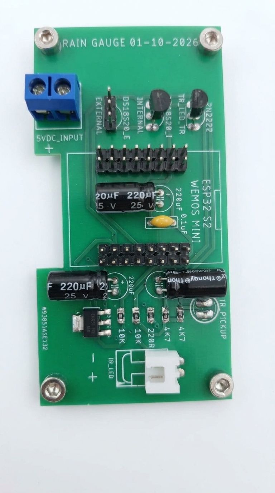
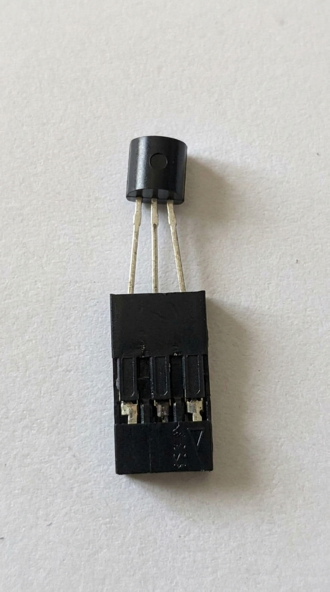
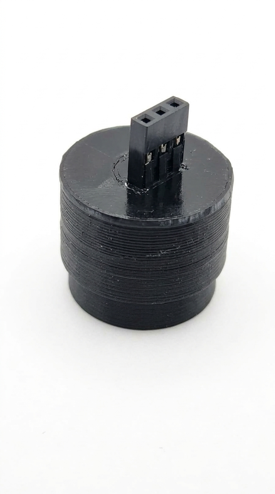

# Rain Gauge

Tipping-bucket rain gauge with an IR beam pickup, outside temperature, rainfall
reports, a daily soil water balance (FAO-56) and an **"irrigate today?"** answer
for an irrigation controller — on a **WEMOS LOLIN S2 Mini** (ESP32-S2). Everything
is a web page on your own WiFi; no cloud, no app needed.

**Install / update page:** https://777bdvgp.github.io/RainGauge/

**Contents:** [Features](#features) · [1. Printing the parts](#1-printing-the-parts) ·
[2. What else you need](#2-what-else-you-need) · [3. The PCB](#3-the-pcb) ·
[4. The outside temperature sensor](#4-the-outside-temperature-sensor) ·
[5. Assembling the gauge](#5-assembling-the-gauge) ·
[6. Installing the firmware](#6-installing-the-firmware) ·
[7. Testing and calibrating](#7-testing-and-calibrating) · [Updating](#updating) ·
[Pin map](#pin-map) · [Building the firmware yourself](#building-the-firmware-yourself) ·
[Licence](#licence)

> The build guide grows while the next gauge is built. Steps marked
> **(to be completed)** get more detail and photos then.

## Features

- **HOME** — live bucket position (IR beam OPEN / BROKEN), rain today / this month,
  last tip, outside temperature, irrigation answer.
- **REPORTS** — rainfall per month / day / hour, temperature records and daily
  min / max, water balance history.
- **SETTINGS** — funnel size, calibration, tip debounce, IR self-test interval,
  irrigation method (*Water Balance*, *Simple Rule* or *No Irrigation*), controller
  name, START FRESH (clear data, keep settings), SIMULATION.
- **NTFY** — free push alerts on your phone (ntfy.sh): IR sensor fault, high / low
  outside temperature; IR sensor test with live beam status.
- **ABOUT** — network, firmware **update from GitHub** (CHECK / INSTALL) or from an
  uploaded `.bin`, WiFi setup.
- **`/api/irrigate`** — JSON answer any irrigation controller can poll.

## 1. Printing the parts

All parts were printed in **ABS** on an FDM 3D printer.

**Print them exactly as they are in the STL files — do not rotate them.**
Every part is already saved in its print position: when you load an STL into a
slicer such as **Cura**, it lies on the build plate the right way up, with its
flat side down. Just place it on the plate and slice.

The STL files are in the [`Enclosure/`](Enclosure) folder — click a name below to
see the part in 3D on GitHub, then **Download raw file** (the download icon at the
top right).

| File | Part | Size (X × Y × height) |
|---|---|---|
| [`RM_Top.stl`](Enclosure/RM_Top.stl) | Top with the funnel — 146 mm across (= *Funnel Diameter* on the SETTINGS page) | 146 × 146 × 88.6 mm |
| [`RM_Mid.stl`](Enclosure/RM_Mid.stl) | Middle section | 146 × 146 × 74.5 mm |
| [`RM_Base.stl`](Enclosure/RM_Base.stl) | Base | 139 × 115 × 65 mm |
| [`RainMeterTipper.stl`](Enclosure/RainMeterTipper.stl) | Tipping bucket | 98 × 23 × 28 mm |
| [`PCBLift.stl`](Enclosure/PCBLift.stl) | PCB lift / spacer | 44 × 24 × 3 mm |
| [`TempSupportPlug.stl`](Enclosure/TempSupportPlug.stl) | Holder for the outside temperature sensor | 21 × 21 × 17.5 mm |
| [`IR_LED_Support.stl`](Enclosure/IR_LED_Support.stl) | Holder for the IR LED (instead of the IR holder PCB) | 24 × 27.6 × 6 mm |

Notes:

- The top and middle need a build plate of at least **150 × 150 mm**.
- ABS warps and cracks when it cools unevenly: an enclosed printer (or a
  draught-free room) and a heated bed help.
- `RainMeterTipper.stl` touches the plate with only a small area — a **brim**
  helps it stay down.
- The tipping bucket must swing freely and the same way to both sides: clean
  any strings or blobs from the pivot after printing.
- After printing, the top and middle are glued, sanded and painted — see
  [section 5](#5-assembling-the-gauge).
- If you change the funnel size, set the new inside diameter on the SETTINGS
  page (*Funnel Diameter*) — the rain in mm is worked out from it.

## 2. What else you need

- **PCB RAINMETER_V1** — Eagle files and gerbers in [`PCB/`](PCB) (order from any
  PCB maker) and the parts in section 3
- **WEMOS LOLIN S2 Mini** (ESP32-S2)
- **IR LED** (5 mm) and **IR pickup** (the beam the tipping bucket breaks) — for the
  IR LED either the small **IR holder PCB** or a printed holder, see
  [The IR LED](#the-ir-led-two-ways-to-mount-it)
- **DS18S20** temperature sensor for outside (a second one on the PCB is optional)
- **Brass heat-set inserts** and matching screws — melted into the base with a
  soldering iron; the top screws onto the base
- 3-pin **Dupont** female crimp terminals + housing for the temperature sensor
- A **5 V DC** power supply

## 3. The PCB



Solder the parts as printed on the board:

| On the board | Part |
|---|---|
| `5VDC_INPUT` | 2-pin screw terminal — 5 V supply in (**+** marked) |
| `ESP32 S2 WEMOS MINI` | pin headers for the S2 Mini |
| `2N2222` / `TR_LED_TR` | 2N2222 transistor that switches the IR LED |
| `IR_LED` | 2-pin connector to the IR LED |
| `IR PICKUP` | the IR pickup |
| `EXTERNAL DS18S20_E` | 3-pin header for the outside temperature sensor |
| `INTERNAL DS18S20_I` | optional DS18S20 on the board (inside temperature) |
| `10K`, `10K`, `220R`, `4K7`, `4K7` | resistors (SMD) |
| `220µF` × 3, `0.1µF` | capacitors |

The full schematic is in [`PCB/RAINMETER_V1.sch`](PCB) (Eagle).
Back of the board: [`PCB_BACK.jpg`](docs/pictures/PCB_BACK.jpg).

### The IR LED: two ways to mount it

The IR LED sits opposite the IR pickup, so the tipping bucket breaks the beam
between them. It connects to the `IR_LED` connector on the main PCB.

- **IR holder PCB** — a small extra board, **36.7 × 22.1 mm**, with only the
  5 mm IR LED and a 2-pin connector (Molex C-Grid 70553-02) for the cable to the
  main PCB. Eagle files and gerbers:
  [`PCB/RAINMETER_IR_HOLDER*`](PCB). Neat, but it is one more PCB to order.
- **Printed holder — cheaper alternative:**
  [`IR_LED_Support.stl`](Enclosure/IR_LED_Support.stl) (24 × 27.6 × 6 mm, printed
  like the other parts). The IR LED is mounted directly in it; solder a 2-wire
  cable to the LED legs and plug it into the `IR_LED` connector on the main PCB
  (mind the **+**). No extra PCB needed.

## 4. The outside temperature sensor

| | |
|---|---|
|  | **a.** Crimp (or solder) a Dupont female terminal on each leg of the DS18S20. |
|  | **b.** Push the three terminals into a 3-pin housing — keep the leg order. |
|  | **c.** Fit it into `TempSupportPlug`: the sensor sits in the cup... |
|  | **d.** ...and the connector comes out at the bottom. |

It connects to the **EXTERNAL DS18S20_E** header on the PCB. **(to be completed:
where the holder fits on the gauge)**

## 5. Assembling the gauge

**(to be completed)**

**The top and middle section (funnel):**

1. **Glue** the **top** (`RM_Top`) and the **middle section** (`RM_Mid`) together
   with an **ABS glue** (ABS cement / solvent glue for ABS). Let it cure fully.
2. **Sand** the **outside** and the **inside of the funnel** smooth — a smooth funnel
   lets the water run down quickly and leaves no drops behind.
3. **Open the small hole at the bottom of the funnel** properly (drill or file it
   clean): all the water must run through it into the tipping bucket. A half-closed
   hole slows the water down or lets it build up in the funnel.
4. **Paint** it. **White** is best: it reflects the sun, so the gauge (and the
   temperature inside it) heats up as little as possible.

**The base and the electronics:**

5. Melt the **brass inserts** into the screw holes of the **base** (`RM_Base`) with a
   soldering iron (let them cool before screwing into them).
6. Mount the PCB on the **PCBLift** in the **base** and screw it down.
7. Fit the **IR LED** (on its holder PCB or in the printed holder) and the
   **IR pickup** into their holes: the holes in the printed parts line them up with
   the **tipping bucket**, so the beam is broken by one side of the bucket and open
   with the other.
8. Put the **tipping bucket** on its pivot — it must tip freely both ways.
9. Connect the IR LED to the `IR_LED` connector, the outside sensor to
   `EXTERNAL DS18S20_E`, and 5 V to `5VDC_INPUT`.

**Putting it together:**

10. Fit the glued **top + middle section** onto the **base** and screw it down into
    the brass inserts.

## 6. Installing the firmware

No PlatformIO needed:

1. Open the [install page](https://777bdvgp.github.io/RainGauge/) in Chrome or Edge,
   plug the S2 Mini into the PC with a USB **data** cable, press **CONNECT**, choose
   **Erase**, then **Install**. (If no port shows up: hold button **0**, tap **RST**,
   release **0**, try again; tap **RST** once more after the install.)
2. The gauge opens the WiFi hotspot **RainGauge-Setup** (the LED blinks fast).
   Connect a phone to it — the setup page opens by itself (otherwise browse to
   `http://192.168.4.1/`). Pick your network, type the password, choose
   **Automatic (DHCP)** or a **fixed IP**, press **SAVE & RESTART**.
3. Put the phone back on your normal WiFi and open `http://raingauge.local/`
   (or the fixed IP). Use a fixed IP when an irrigation controller must read the gauge.

The network can be changed later on the ABOUT page (**WIFI SETUP**). If the gauge
cannot reach its network for several minutes, the hotspot comes back by itself
for 5 minutes.

## 7. Testing and calibrating

1. Tip the bucket by hand and watch **Bucket Position** on the HOME page:
   it must change between **OPEN** (green) and **BROKEN** (red) on every tip.
2. **NTFY page → TEST IR SENSOR NOW** (with the beam OPEN) must report *OK*.
3. Stand the gauge level and **calibrate** it (SETTINGS → CALIBRATION): pour a known
   amount of water (default 500 ml) slowly into the funnel — the gauge learns how
   much water one tip is.
4. **SETTINGS → START FRESH** to clear the test tips (settings and calibration are kept).
5. Set the **Irrigation Answer Method** (or *No Irrigation* for a plain rain meter),
   your **latitude**, soil type, root depth and garden factor on SETTINGS, and
   NTFY alerts if you want them.

## Updating

ABOUT page → **CHECK FOR UPDATE** → **INSTALL FROM GITHUB**. The new firmware goes
into the spare app slot and is only used when it arrived complete and verified
(HTTPS with certificate check); settings, calibration and rain history are kept.
Without internet at the gauge: download `docs/firmware/raingauge.bin` and use
**UPLOAD & INSTALL** on the ABOUT page.

## Pin map

| Part | GPIO | Notes |
|---|---|---|
| IR LED (2N2222) | 2 | HIGH = on; LED from 5 V via 220R (~16 mA) |
| IR pickup | 17 | 10k pull-up; LOW = light received, HIGH = beam broken |
| DS18S20 outside | 6 | 4k7 pull-up |
| DS18S20 inside (optional) | 1 | 4k7 pull-up |
| Heartbeat LED | 15 | fast blink = WiFi setup hotspot |

Every change of the pickup (both bucket sides) is one tip.

## Building the firmware yourself

```
cd RainGauge
pio run -e usb -t upload                                  # first time, USB
pio run -e ota -t upload --upload-port <gauge ip>         # later, over WiFi
```

Each build writes `firmware_out/RainGauge_v<ver>.bin` (update) and
`RainGauge_v<ver>_full.bin` (new board). Optional built-in WiFi networks:
`src/wifi_secrets.example.h` (your copy `wifi_secrets.h` is never committed).

Publishing a new version (maintainer): `python sync_from_private.py`, build,
`python update_firmware.py "note"`, commit, push.

## Licence

CC BY-NC 4.0 — see [LICENSE](LICENSE). No warranty: check the irrigation answer
against your own garden before relying on it.
